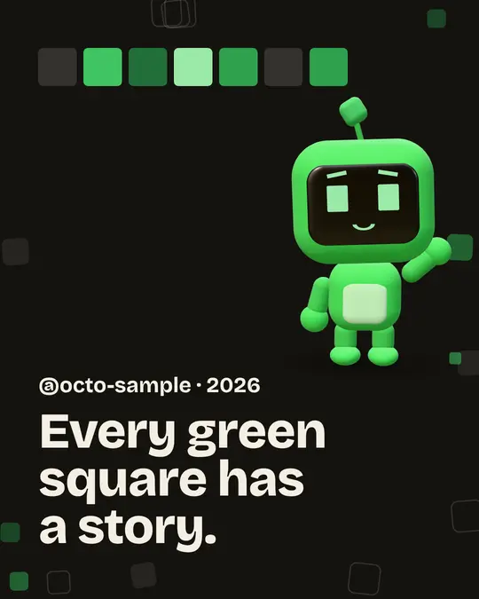
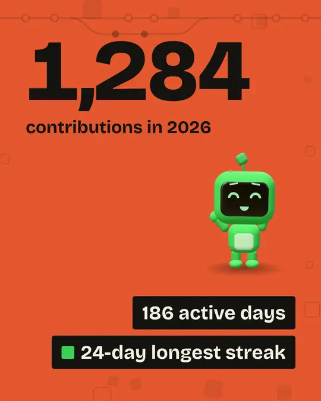
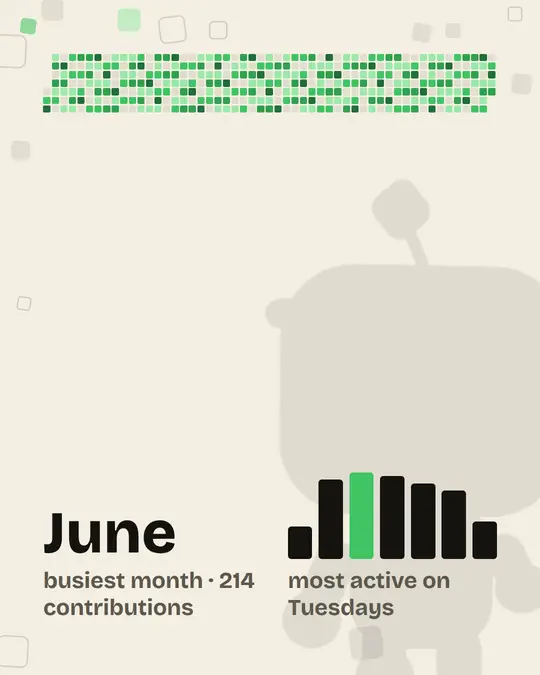
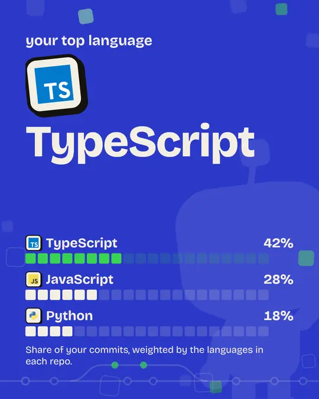
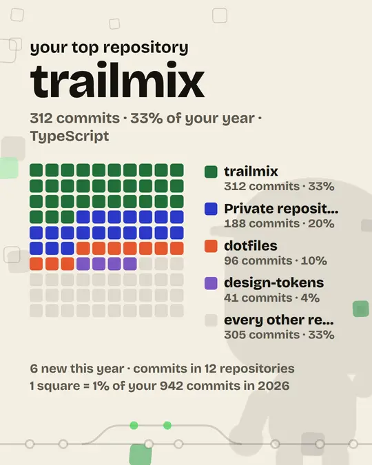
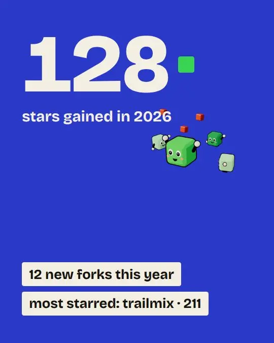
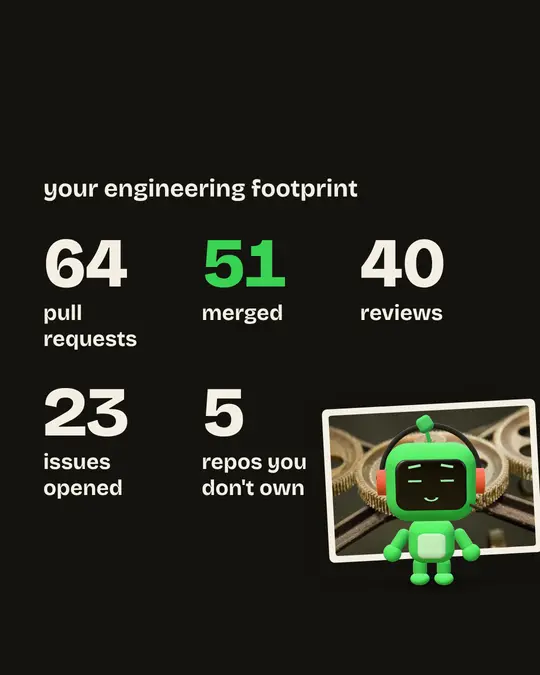
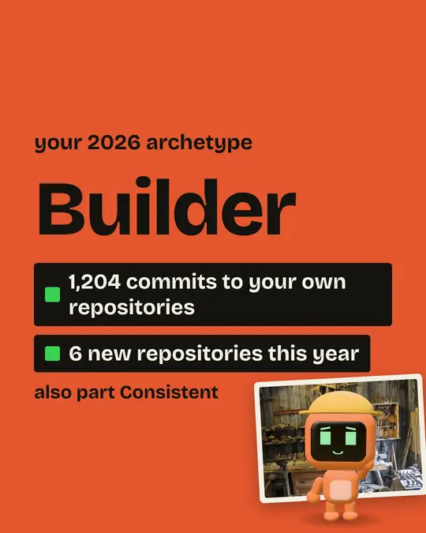
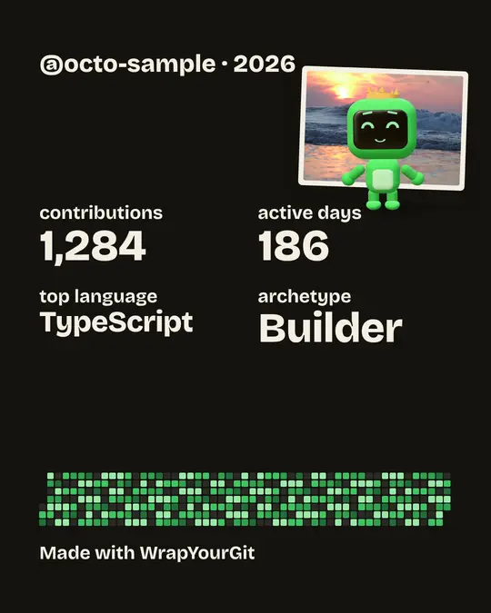
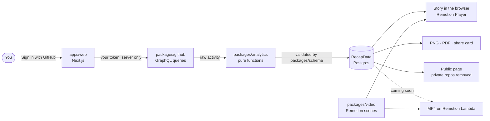

<a id="readme-top"></a>

<div align="center">

<a href="https://wrapyourgit.habibiahmada.dev">
  <picture>
    <source media="(prefers-color-scheme: dark)" srcset=".github/assets/logo-dark.svg">
    
  </picture>
</a>

### Every green square has a story. Here's yours, in motion.

Your GitHub year, played back as a short animated story with its own soundtrack:<br>
contributions, streaks, the languages you lived in, the projects you built, and the kind of developer you turned out to be.

[](https://github.com/habibiahmada/wrapyourgit/actions/workflows/ci.yml)
[](LICENSE)
[](https://wrapyourgit.habibiahmada.dev)
[](CONTRIBUTING.md)

[](https://nextjs.org)
[](https://www.remotion.dev)
[](https://www.typescriptlang.org)
[](https://tailwindcss.com)
[](https://bun.sh)
[](https://www.postgresql.org)

**[Get your recap](https://wrapyourgit.habibiahmada.dev)** ·
[How it works](#how-it-works) ·
[Privacy](#privacy-by-design) ·
[Report a bug](https://github.com/habibiahmada/wrapyourgit/issues/new?template=bug_report.yml) ·
[Request a feature](https://github.com/habibiahmada/wrapyourgit/issues/new?template=feature_request.yml)

<br>


</div>

<details>
<summary><strong>Table of contents</strong></summary>

- [Why WrapYourGit](#why-wrapyourgit)
- [The story, in nine chapters](#the-story-in-nine-chapters)
- [What kind of developer were you?](#what-kind-of-developer-were-you)
- [What you keep](#what-you-keep)
- [Privacy by design](#privacy-by-design)
- [How it works](#how-it-works)
- [Tech stack](#tech-stack)
- [Run it locally](#run-it-locally)
- [Project structure](#project-structure)
- [Documentation](#documentation)
- [Roadmap](#roadmap)
- [Contributing](#contributing)
- [License and credits](#license-and-credits)

</details>

## Why WrapYourGit

- **Numbers you can trust.** Every metric has a written definition and a GitHub source in [metrics.md](docs/analytics/metrics.md). Your 2026 total matches the "contributions in 2026" on your profile. When GitHub doesn't provide something, the recap says _unavailable_ instead of showing a misleading 0, and estimates are marked with "~".
- **A story, not a dashboard.** Nine short chapters set to a soundtrack, a warm-up before them, a comparison with last year after, and a letter from Cell that reads your year the way a friend would. A quiet year is told it counts; a relentless one is told to rest.
- **Your private work counts.** Contributions to private repositories, yours and your organisations', are in your total. Their names never appear in anything you can share.
- **Read-only, and yours to delete.** Signing in asks GitHub for no repository permissions, the code is never read, and "Delete my data" removes everything and revokes access.

<p align="right"><a href="#readme-top">back to top</a></p>

## The story, in nine chapters

About a minute of music. Each chapter waits for you, so you go at your own pace.

<table>
  <tr>
    <td align="center" width="33%"><br><b>1. Intro</b><br><sub>Your first week lights up</sub></td>
    <td align="center" width="33%"><br><b>2. Contributions</b><br><sub>Total, active days, longest streak</sub></td>
    <td align="center" width="33%"><br><b>3. Rhythm</b><br><sub>Your calendar, busiest month, weekdays</sub></td>
  </tr>
  <tr>
    <td align="center"><br><b>4. Tech DNA</b><br><sub>Languages, weighted by what you committed</sub></td>
    <td align="center"><br><b>5. Projects</b><br><sub>Your most active repositories</sub></td>
    <td align="center"><br><b>6. Community</b><br><sub>Stars and forks gained, what you starred</sub></td>
  </tr>
  <tr>
    <td align="center"><br><b>7. Engineering</b><br><sub>Pull requests, reviews, issues</sub></td>
    <td align="center"><br><b>8. Identity</b><br><sub>Your archetype and why</sub></td>
    <td align="center"><br><b>9. Closing</b><br><sub>Your year on one card</sub></td>
  </tr>
</table>

<sub>Frames from a recap built on sample data, not a real account.</sub>

<p align="right"><a href="#readme-top">back to top</a></p>

## What kind of developer were you?

The climax of the story names your archetype, with the facts that earned it. You get one, plus up to two runner-ups you came close to. If none fits yet, the story says so honestly.

<table>
  <tr>
    <td align="center" width="33%"><br><b>Builder</b> · orange, in a hard hat, hammering in the workshop<br><sub>Created two or more repositories, or made 50+ commits to your own.</sub></td>
    <td align="center" width="33%"><br><b>Consistent</b> · green, in a sweatband, running laps on the track<br><sub>Active on at least 30% of the days so far.</sub></td>
    <td align="center" width="33%"><br><b>Explorer</b> · sky blue, cap and backpack, waving from the mountains<br><sub>Wrote in four or more languages.</sub></td>
  </tr>
  <tr>
    <td align="center"><br><b>Collaborator</b> · pink, in a headset, handing work on over a shared map<br><sub>Ten or more reviews, or ten or more pull requests to other people's repositories.</sub></td>
    <td align="center"><br><b>Night owl</b> · lavender, owl tufts and glasses, grooving over the city at night<br><sub>40%+ of sampled commits between 22:00 and 04:00. Estimated, and labelled so.</sub></td>
    <td align="center"><br><b>Open sourcer</b> · teal, in a scarf, cheering by a community mural<br><sub>Contributed to three or more public repositories you don't own.</sub></td>
  </tr>
</table>

<p align="right"><a href="#readme-top">back to top</a></p>

## What you keep

|                          |                                                                                                             |
| ------------------------ | ----------------------------------------------------------------------------------------------------------- |
| 🎬 **The story**         | Plays in your browser with its own soundtrack, chapter by chapter.                                          |
| 🖼️ **Ten slides as PNG** | One 1080 × 1350 image per chapter plus the letter, or all ten in a ZIP.                                     |
| 📄 **One PDF**           | The same ten slides in a single file, for keeping or printing.                                              |
| 🔗 **A public page**     | Off until you publish it. Then your year lives at `/u/<your-login>`, with private repository names removed. |
| 🪪 **A share card**      | A 1200 × 630 image for social posts, also used as the page's preview.                                       |
| 🎞️ **An MP4 video**      | In 9:16, 4:5, 1:1 and 16:9. _Coming soon: rendering is being set up._                                       |

The dashboard adds a profile-style overview: your calendar, highlights, languages, this year against the same span of last year, and the repositories that caught your eye.

## Privacy by design


- **What it reads:** the counts GitHub keeps about your year (contributions, languages, repositories you committed to, stars, pull requests).
- **What it never touches:** your code. Signing in asks for no repository permissions at all.
- **Where your token lives:** on the server only, encrypted with AES-256-GCM. Never sent to your browser.
- **What goes public:** nothing until you publish. A published recap drops private repository names, your timezone and the hours you commit.
- **How to leave:** Settings → Delete my data removes everything and revokes WrapYourGit's access.

Full policy: [wrapyourgit.habibiahmada.dev/privacy](https://wrapyourgit.habibiahmada.dev/privacy).

<br clear="right">

<p align="right"><a href="#readme-top">back to top</a></p>

## How it works



One validated document, `RecapData`, is the contract between everything: GitHub data goes in once, and the same scenes render in the browser and (soon) to video, so the numbers on screen and in the export never disagree. More in the [architecture overview](docs/architecture/overview.md).

## Tech stack

| Area            | Tools                                                                             |
| --------------- | --------------------------------------------------------------------------------- |
| Web             | Next.js 16 (App Router, Cache Components), React 19, Tailwind CSS 4               |
| Story and video | Remotion 4, React Three Fiber for the illustrations, a synthesised CC0 soundtrack |
| Data            | GitHub GraphQL API, Zod 4 schemas, PostgreSQL with Drizzle ORM                    |
| Auth            | GitHub App user authorisation with PKCE, AES-256-GCM token encryption             |
| Tooling         | Bun workspaces, TypeScript strict, Biome, `bun test`, GitHub Actions              |

## Run it locally

Requires [Bun](https://bun.sh) 1.4+, Node 22+, and Docker or Podman for the database.

```bash
git clone https://github.com/habibiahmada/wrapyourgit.git
cd wrapyourgit
bun install
cp .env.example apps/web/.env.local     # fill in your GitHub App and database settings
bun scripts/dev-db.ts                   # Postgres on localhost:54329
bun run --filter @wyg/web db:migrate
bun run dev                             # http://localhost:3000
```

Just want to see the video? `bun run studio` opens Remotion Studio with sample data, no sign-in needed. The full guide, including creating your own GitHub App, is in [docs/development/setup.md](docs/development/setup.md).

| Command             | What it does                                         |
| ------------------- | ---------------------------------------------------- |
| `bun run dev`       | Web app on http://localhost:3000                     |
| `bun run studio`    | Remotion Studio with sample data                     |
| `bun test`          | Unit tests                                           |
| `bun run typecheck` | Strict TypeScript in every workspace                 |
| `bun run lint`      | Biome lint and format check (`bun run format` fixes) |
| `bun run build`     | Production build of the web app                      |

## Project structure

```
apps/
  web/          Next.js: landing, sign-in, dashboard, story, public pages, SEO
  renderer/     Remotion Lambda deploy and render jobs (MP4, coming soon)
packages/
  schema/       RecapData zod schema and video formats: the contract
  github/       GitHub GraphQL client and queries
  analytics/    Pure functions from raw activity to RecapData, with tests
  video/        Remotion scenes, illustrations, soundtrack
scripts/        Data spike, local database, art and track generation
docs/           Product spec, metric definitions, ADRs, design, setup
```

## Documentation

| Read                                                                            | For                                                   |
| ------------------------------------------------------------------------------- | ----------------------------------------------------- |
| [docs/analytics/metrics.md](docs/analytics/metrics.md)                          | How every number is defined and where it comes from   |
| [docs/architecture/overview.md](docs/architecture/overview.md)                  | System shape, data flow, auth and sync                |
| [docs/architecture/decisions](docs/architecture/decisions)                      | Architecture decision records                         |
| [DESIGN.md](DESIGN.md)                                                          | Visual direction for the story, video and web         |
| [docs/video/scene-system.md](docs/video/scene-system.md)                        | Scenes, layouts, soundtrack and export                |
| [docs/product/prd.md](docs/product/prd.md) · [roadmap](docs/product/roadmap.md) | What we build, and when                               |
| [AGENTS.md](AGENTS.md)                                                          | The short guide for contributors and AI coding agents |

## Roadmap

- [x] Sign in with GitHub, sync, dashboard and the nine-chapter story
- [x] Slides as PNG, ZIP and PDF; opt-in public page and share card
- [x] Comparison with last year; repositories you starred
- [ ] MP4 export in four aspect ratios on Remotion Lambda
- [ ] More soundtracks
- [ ] Final 2026 recaps after the year ends

See the [roadmap](docs/product/roadmap.md) and [changelog](CHANGELOG.md) for detail.

## Contributing

Contributions are welcome, from a wrong number you spotted to a new scene. Start with [CONTRIBUTING.md](CONTRIBUTING.md), and please follow the [Code of Conduct](CODE_OF_CONDUCT.md). Security issues go through [SECURITY.md](SECURITY.md), never a public issue.

## License and credits

WrapYourGit is released under the [MIT License](LICENSE). Its dependencies keep their own licences ([third-party notices](THIRD_PARTY_NOTICES.md)); notably **Remotion is not MIT** and needs a company licence for companies with more than three employees ([remotion.dev/license](https://www.remotion.dev/license)).

- Language logos from [Devicon](https://github.com/devicons/devicon) (MIT); the logos are trademarks of their owners.
- The soundtrack is synthesised by `scripts/synth-track.ts` and released as CC0.
- Fonts: [Mona Sans](https://github.com/github/mona-sans) and [Bricolage Grotesque](https://fonts.google.com/specimen/Bricolage+Grotesque) (SIL Open Font License).
- Inspired by Spotify Wrapped and the open-source year-in-review projects before it, including [GitHub Unwrapped](https://www.githubunwrapped.com) by Remotion.

Not affiliated with or endorsed by GitHub. GitHub and the contribution graph are trademarks of GitHub, Inc.

<div align="center">
<br>
Made by <a href="https://habibiahmada.dev">habibiahmada</a> · <a href="https://wrapyourgit.habibiahmada.dev">wrapyourgit.habibiahmada.dev</a>
<br><br>
<p align="right"><a href="#readme-top">back to top</a></p>
</div>
