<a id="readme-top"></a>

<div align="center">

<a href="https://wrapyourgit.habibiahmada.dev">
  <picture>
    <source media="(prefers-color-scheme: dark)" srcset=".github/assets/logo-dark.svg">
    
  </picture>
</a>

### Every green square has a story. Here's yours, in motion.

Your GitHub year, played back as a short animated story with its own soundtrack:<br>
contributions, streaks, the languages you lived in, the projects you built, and the kind of developer you turned out to be.

[](https://github.com/habibiahmada/wrapyourgit/actions/workflows/ci.yml)
[](LICENSE)
[](https://wrapyourgit.habibiahmada.dev)
[](CONTRIBUTING.md)

[](https://nextjs.org)
[](https://www.remotion.dev)
[](https://www.typescriptlang.org)
[](https://tailwindcss.com)
[](https://bun.sh)
[](https://www.postgresql.org)

**[Get your recap](https://wrapyourgit.habibiahmada.dev)** ·
[How it works](#how-it-works) ·
[Privacy](#privacy-by-design) ·
[Report a bug](https://github.com/habibiahmada/wrapyourgit/issues/new?template=bug_report.yml) ·
[Request a feature](https://github.com/habibiahmada/wrapyourgit/issues/new?template=feature_request.yml)

<br>

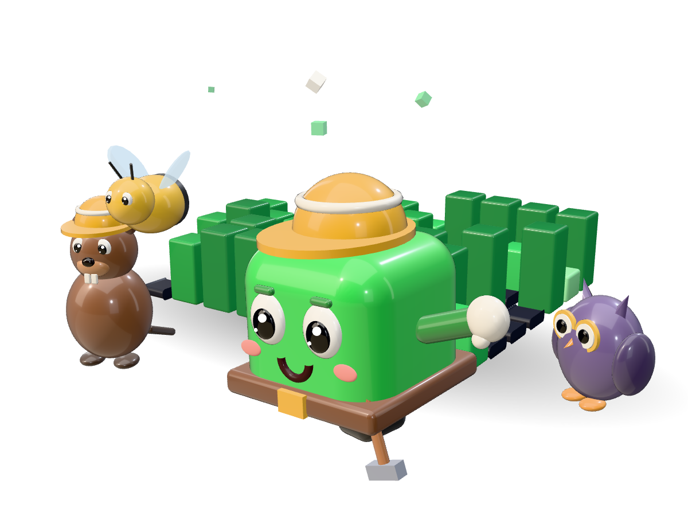

</div>

<details>
<summary><strong>Table of contents</strong></summary>

- [Why WrapYourGit](#why-wrapyourgit)
- [The story, as a city](#the-story-as-a-city)
- [What kind of developer were you?](#what-kind-of-developer-were-you)
- [What you keep](#what-you-keep)
- [Privacy by design](#privacy-by-design)
- [How it works](#how-it-works)
- [Tech stack](#tech-stack)
- [Run it locally](#run-it-locally)
- [Project structure](#project-structure)
- [Documentation](#documentation)
- [Roadmap](#roadmap)
- [Contributing](#contributing)
- [License and credits](#license-and-credits)

</details>

## Why WrapYourGit

- **Numbers you can trust.** Every metric has a written definition and a GitHub source in [metrics.md](docs/analytics/metrics.md). Your 2026 total matches the "contributions in 2026" on your profile. When GitHub doesn't provide something, the recap says _unavailable_ instead of showing a misleading 0, and estimates are marked with "~".
- **A story, not a dashboard.** Your year becomes a city with one building per day, and the camera flies through it stop by stop to a soundtrack: your busiest day, your rhythm, your languages, a comparison with last year, and a letter from Cell that reads your year the way a friend would. A quiet year is told it counts; a relentless one is told to rest.
- **Your private work counts.** Contributions to private repositories, yours and your organisations', are in your total. Your public page and its card never name them; your own story and downloads show the names only if you choose to, and you can change that in Settings.
- **Anyone's year, by username.** Type a GitHub username and its public recap plays, read with the server's own read-only token. Signing in adds your private contribution counts to your own.
- **Read-only, and yours to delete.** Signing in asks GitHub for no repository permissions, the code is never read, and "Delete my data" removes everything, hides your public recap and revokes access.

<p align="right"><a href="#readme-top">back to top</a></p>

## The story, as a city

Your year becomes a city, one building per day. The camera stops at 14 places and waits for your tap, so you go at your own pace; the MP4 holds each stop for about three seconds instead. Nine of the stops:

<table>
  <tr>
    <td align="center" width="33%">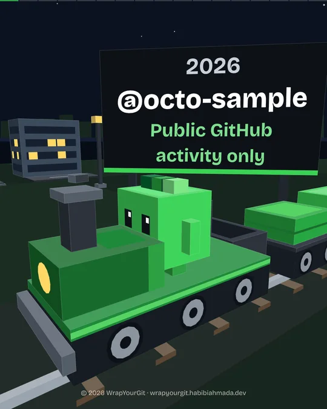<br><b>1. Hello</b><br><sub>Cell says hi</sub></td>
    <td align="center" width="33%">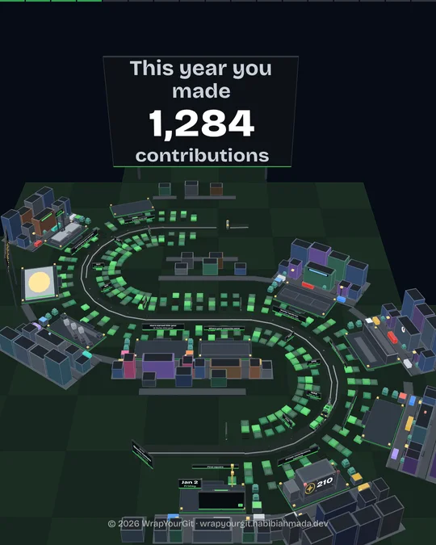<br><b>4. Your year as a city</b><br><sub>One building per day</sub></td>
    <td align="center" width="33%">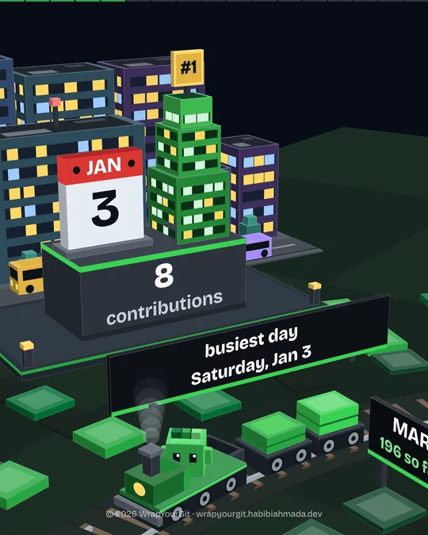<br><b>5. Your busiest day</b><br><sub>The tallest building</sub></td>
  </tr>
  <tr>
    <td align="center">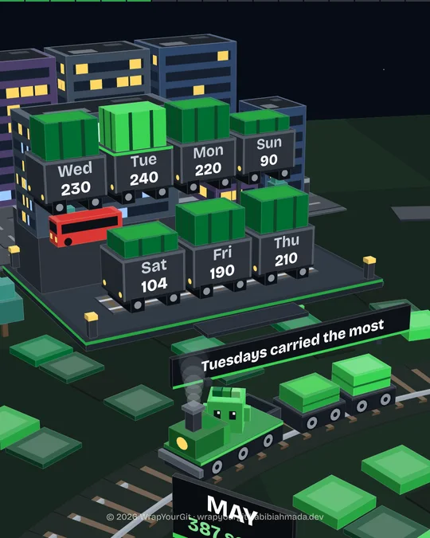<br><b>6. Your rhythm</b><br><sub>Your weekdays, as a train</sub></td>
    <td align="center">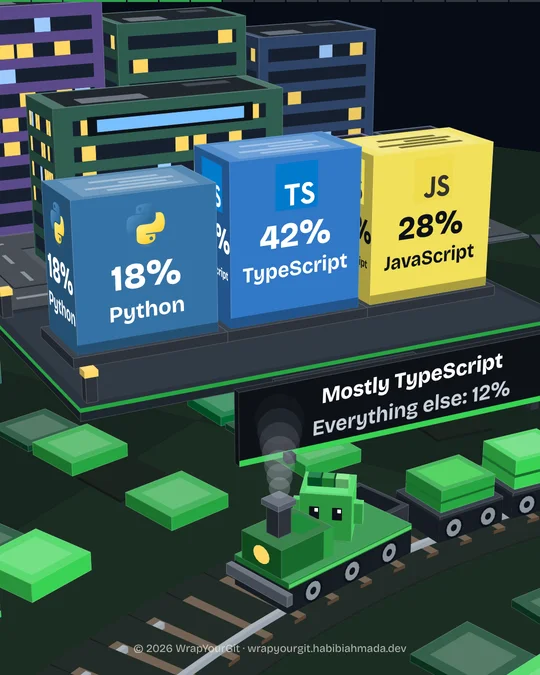<br><b>7. Languages</b><br><sub>A garden, weighted by what you committed</sub></td>
    <td align="center">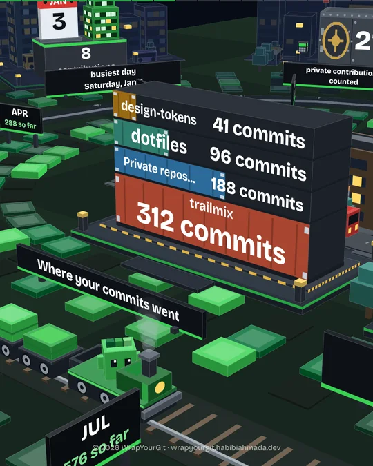<br><b>8. Projects</b><br><sub>Where your commits went</sub></td>
  </tr>
  <tr>
    <td align="center">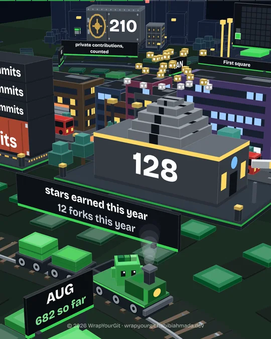<br><b>9. Community</b><br><sub>Stars and forks</sub></td>
    <td align="center">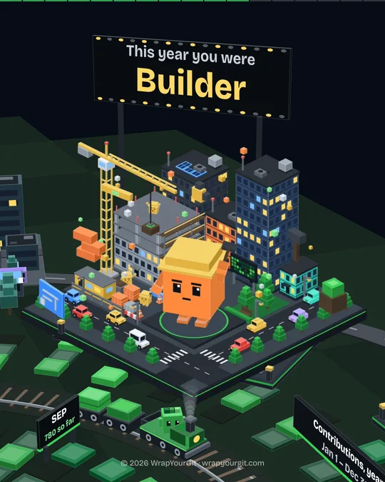<br><b>11. Your archetype</b><br><sub>And why</sub></td>
    <td align="center">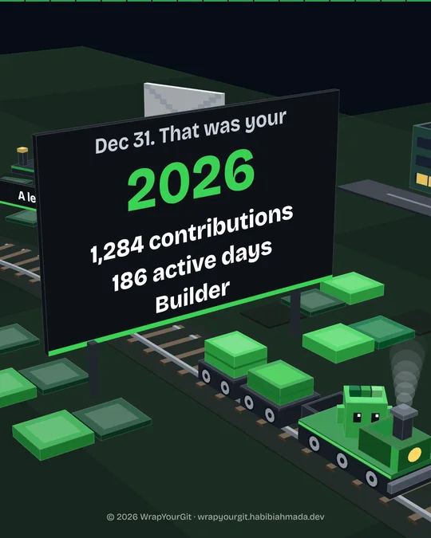<br><b>14. The year in one frame</b><br><sub>Fireworks over the city</sub></td>
  </tr>
</table>

<sub>Frames from a recap built on sample data, not a real account.</sub>

<p align="right"><a href="#readme-top">back to top</a></p>

## What kind of developer were you?

The climax of the story names your archetype, with the facts that earned it. You get one, plus up to two runner-ups you came close to. If none fits yet, the story says so honestly.

<table>
  <tr>
    <td align="center" width="33%">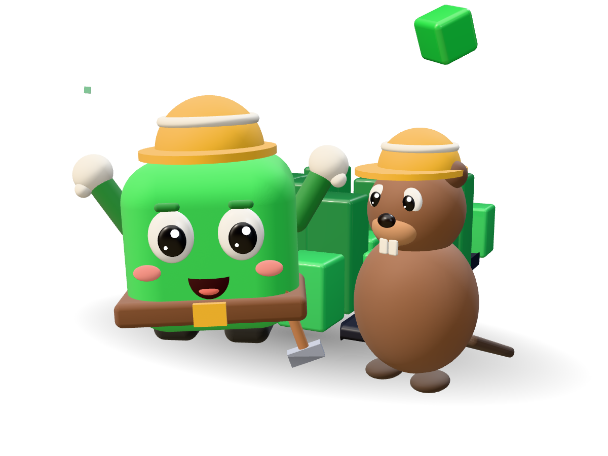<br><b>Builder</b> · orange, in a hard hat, hammering in the workshop<br><sub>Created two or more repositories, or made 50+ commits to your own.</sub></td>
    <td align="center" width="33%">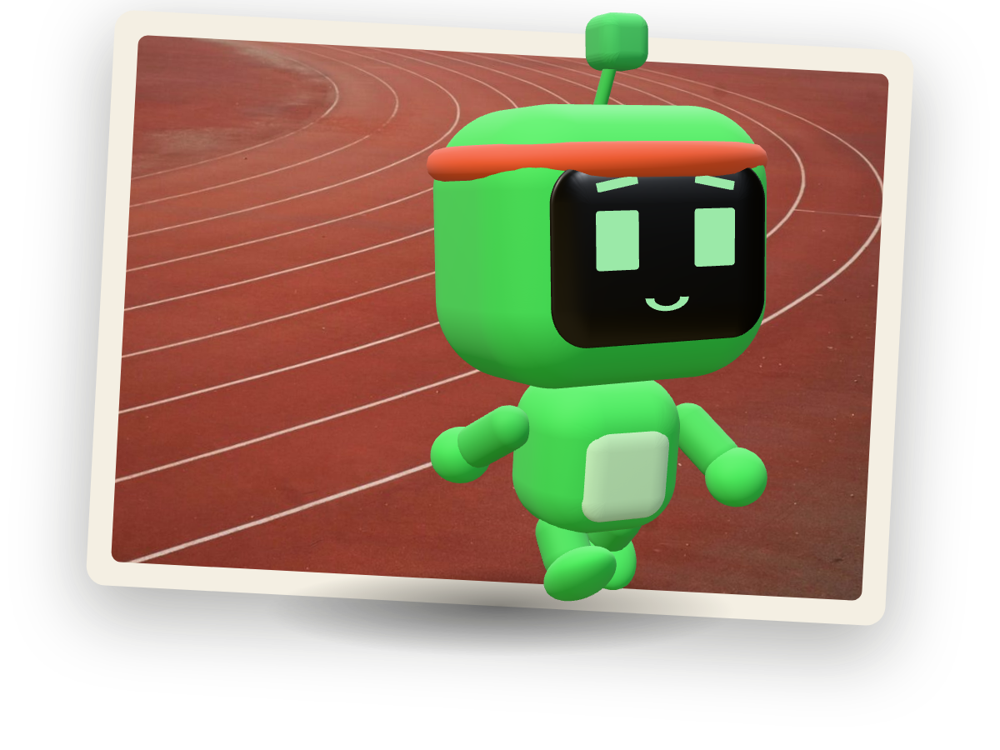<br><b>Consistent</b> · green, in a sweatband, running laps on the track<br><sub>Active on at least 30% of the days so far.</sub></td>
    <td align="center" width="33%">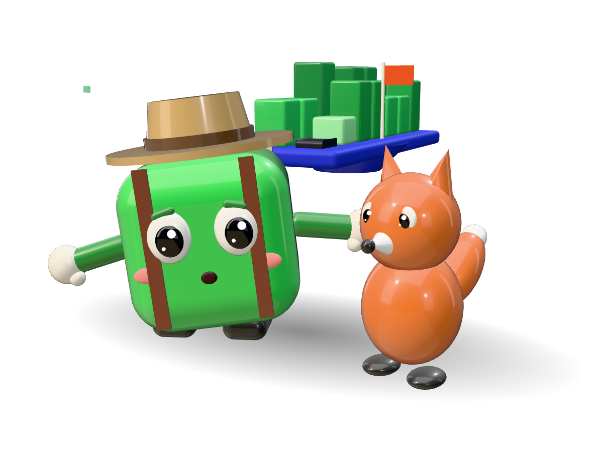<br><b>Explorer</b> · sky blue, cap and backpack, waving from the mountains<br><sub>Wrote in four or more languages.</sub></td>
  </tr>
  <tr>
    <td align="center">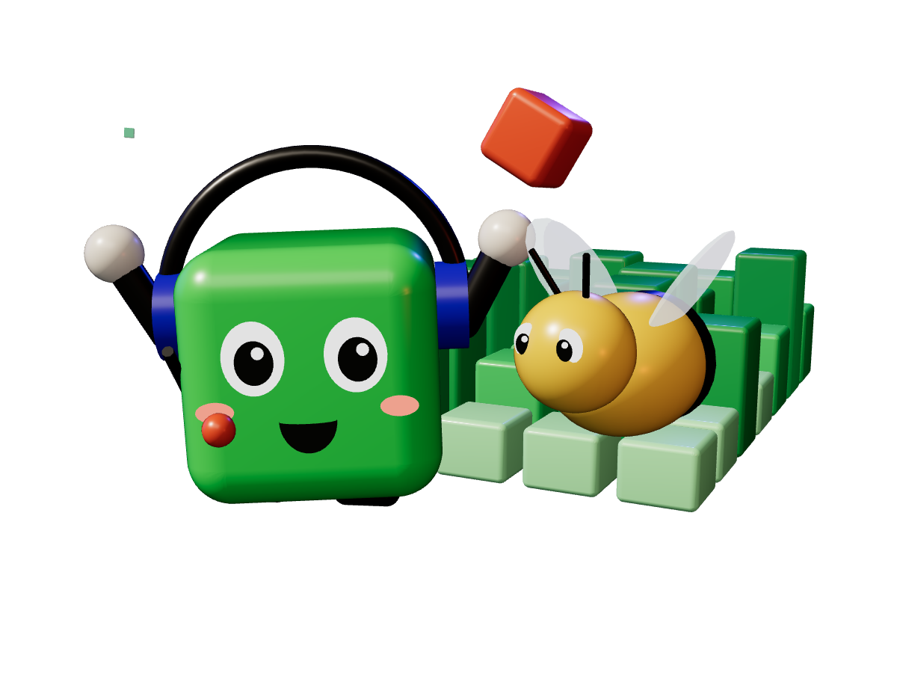<br><b>Collaborator</b> · pink, in a headset, handing work on over a shared map<br><sub>Ten or more reviews, or ten or more pull requests to other people's repositories.</sub></td>
    <td align="center">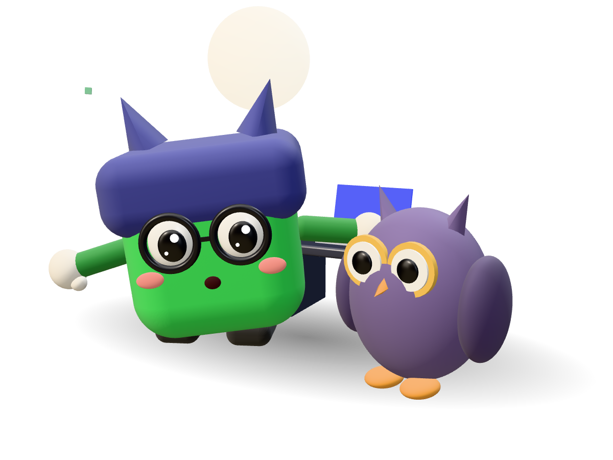<br><b>Night owl</b> · lavender, owl tufts and glasses, grooving over the city at night<br><sub>40%+ of sampled commits between 22:00 and 04:00. Estimated, and labelled so.</sub></td>
    <td align="center">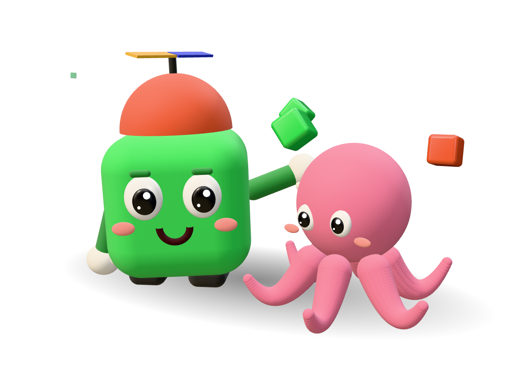<br><b>Open sourcer</b> · teal, in a scarf, cheering by a community mural<br><sub>Contributed to three or more public repositories you don't own.</sub></td>
  </tr>
</table>

<p align="right"><a href="#readme-top">back to top</a></p>

## What you keep

|                      |                                                                                                                            |
| -------------------- | -------------------------------------------------------------------------------------------------------------------------- |
| 🎬 **The story**     | Plays in your browser with its own soundtrack, stop by stop.                                                               |
| 🖼️ **Slides as PNG** | One 1080 × 1350 image per stop of the story, letter pages included, or all of them in a ZIP. Rendered in your own browser. |
| 📄 **One PDF**       | The same slides in a single file, for keeping or printing.                                                                 |
| 🔗 **A public page** | Every GitHub username has one at `/<username>`, built from public activity only. You can hide yours in Settings.           |
| 🪪 **A share card**  | A 1200 × 630 image for social posts, also used as the page's preview.                                                      |
| 🎞️ **An MP4 video**  | In 9:16, 4:5, 1:1 and 16:9, with the soundtrack, rendered in your own browser.                                             |

The dashboard adds a profile-style overview: your calendar, highlights, languages, this year against the same span of last year, and the repositories that caught your eye.

## Privacy by design

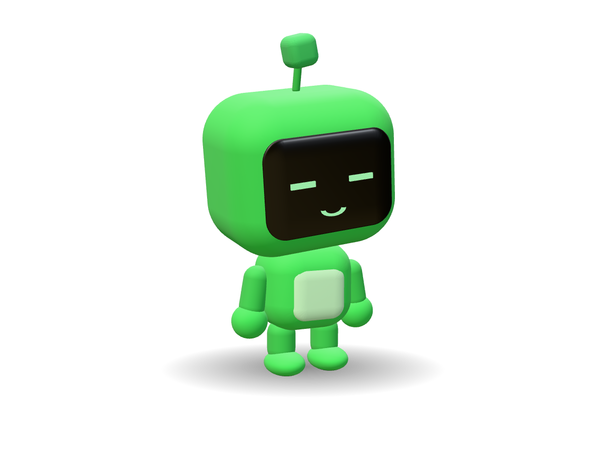

- **What it reads:** the counts GitHub keeps about your year (contributions, languages, repositories you committed to, stars, pull requests).
- **What it never touches:** your code. Signing in asks for no repository permissions at all.
- **Where your token lives:** on the server only, encrypted with AES-256-GCM. Never sent to your browser.
- **What goes public:** a recap of your public GitHub activity at `/<your-username>`, like your profile. It never shows private repository names, your timezone or the hours you commit, and Settings has a switch to hide it.
- **How to leave:** Settings → Delete my data removes everything and revokes WrapYourGit's access.

Full policy: [wrapyourgit.habibiahmada.dev/privacy](https://wrapyourgit.habibiahmada.dev/privacy).

<br clear="right">

<p align="right"><a href="#readme-top">back to top</a></p>

## How it works

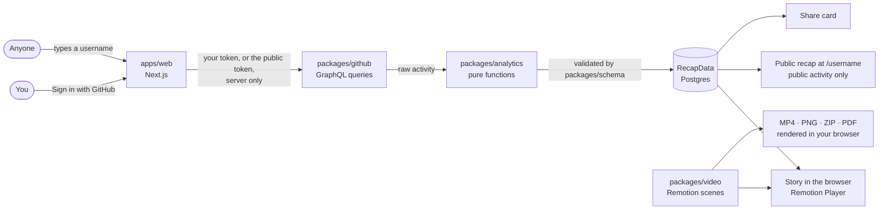

One validated document, `RecapData`, is the contract between everything: GitHub data goes in once, and the same scenes play in the browser and render to video and slides there, so the numbers on screen and in the export never disagree. More in the [architecture overview](docs/architecture/overview.md).

## Tech stack

| Area            | Tools                                                                                                      |
| --------------- | ---------------------------------------------------------------------------------------------------------- |
| Web             | Next.js 16 (App Router, Cache Components), React 19, Tailwind CSS 4                                        |
| Story and video | Remotion 4, baked 3D art (animated WebP and stills, no WebGL in the browser), a synthesised CC0 soundtrack |
| Data            | GitHub GraphQL API, Zod 4 schemas, PostgreSQL with Drizzle ORM                                             |
| Auth            | GitHub App user authorisation with PKCE, AES-256-GCM token encryption                                      |
| Tooling         | Bun workspaces, TypeScript strict, Biome, `bun test`, GitHub Actions                                       |

## Run it locally

Requires [Bun](https://bun.sh) 1.4+, Node 22+, and Docker or Podman for the database.

```bash
git clone https://github.com/habibiahmada/wrapyourgit.git
cd wrapyourgit
bun install
cp .env.example apps/web/.env.local     # fill in your GitHub App and database settings
bun scripts/dev-db.ts                   # Postgres on localhost:54329
bun run --filter @wyg/web db:migrate
bun run dev                             # http://localhost:3000
```

Just want to see the video? `bun run studio` opens Remotion Studio with sample data, no sign-in needed. The full guide, including creating your own GitHub App, is in [docs/development/setup.md](docs/development/setup.md); running it on a server is in [docs/deployment/guide.md](docs/deployment/guide.md).

| Command             | What it does                                         |
| ------------------- | ---------------------------------------------------- |
| `bun run dev`       | Web app on http://localhost:3000                     |
| `bun run studio`    | Remotion Studio with sample data                     |
| `bun test`          | Unit tests                                           |
| `bun run typecheck` | Strict TypeScript in every workspace                 |
| `bun run lint`      | Biome lint and format check (`bun run format` fixes) |
| `bun run build`     | Production build of the web app                      |

## Project structure

```
apps/
  web/          Next.js: landing, sign-in, dashboard, story, public pages, SEO
packages/
  schema/       RecapData zod schema and video formats: the contract
  github/       GitHub GraphQL client and queries
  analytics/    Pure functions from raw activity to RecapData, with tests
  video/        Remotion scenes, illustrations, soundtrack
scripts/        Data spike, local database, art and track generation, dev stills (lib/still.ts)
docs/           Product spec, metric definitions, ADRs, design, setup
```

## Documentation

| Read                                                                            | For                                                   |
| ------------------------------------------------------------------------------- | ----------------------------------------------------- |
| [docs/analytics/metrics.md](docs/analytics/metrics.md)                          | How every number is defined and where it comes from   |
| [docs/architecture/overview.md](docs/architecture/overview.md)                  | System shape, data flow, auth and sync                |
| [docs/architecture/decisions](docs/architecture/decisions)                      | Architecture decision records                         |
| [DESIGN.md](DESIGN.md)                                                          | Visual direction for the story, video and web         |
| [docs/video/scene-system.md](docs/video/scene-system.md)                        | Scenes, layouts, soundtrack and export                |
| [docs/product/prd.md](docs/product/prd.md) · [roadmap](docs/product/roadmap.md) | What we build, and when                               |
| [AGENTS.md](AGENTS.md)                                                          | The short guide for contributors and AI coding agents |

## Roadmap

- [x] Sign in with GitHub, sync, dashboard and the nine-chapter story
- [x] Slides as PNG, ZIP and PDF; public page and share card
- [x] A recap for any GitHub username at `/<username>`, which its owner can hide
- [x] Comparison with last year; repositories you starred
- [x] The story as one continuous world with a moving camera ([design](docs/superpowers/specs))
- [x] MP4, slides and PDF rendered in your browser, in four aspect ratios
- [ ] More soundtracks
- [ ] Final 2026 recaps after the year ends

See the [roadmap](docs/product/roadmap.md) and [changelog](CHANGELOG.md) for detail.

## Contributing

Contributions are welcome, from a wrong number you spotted to a new scene. Start with [CONTRIBUTING.md](CONTRIBUTING.md), and please follow the [Code of Conduct](CODE_OF_CONDUCT.md). Security issues go through [SECURITY.md](SECURITY.md), never a public issue.

## License and credits

WrapYourGit is released under the [MIT License](LICENSE). Its dependencies keep their own licences ([third-party notices](THIRD_PARTY_NOTICES.md)); notably **Remotion is not MIT** and needs a company licence for companies with more than three employees ([remotion.dev/license](https://www.remotion.dev/license)).

- Language logos from [Devicon](https://github.com/devicons/devicon) (MIT); the logos are trademarks of their owners.
- The soundtrack is synthesised by `scripts/synth-track.ts` and released as CC0.
- Fonts: [Mona Sans](https://github.com/github/mona-sans) and [Bricolage Grotesque](https://fonts.google.com/specimen/Bricolage+Grotesque) (SIL Open Font License).
- Inspired by Spotify Wrapped and the open-source year-in-review projects before it, including [GitHub Unwrapped](https://www.githubunwrapped.com) by Remotion.

WrapYourGit is an independent project. It reads your activity through the public GitHub API; GitHub is a trademark of GitHub, Inc.

<div align="center">
<br>
Made by <a href="https://habibiahmada.dev">habibiahmada</a> · <a href="https://wrapyourgit.habibiahmada.dev">wrapyourgit.habibiahmada.dev</a>
<br><br>
<p align="right"><a href="#readme-top">back to top</a></p>
</div>
